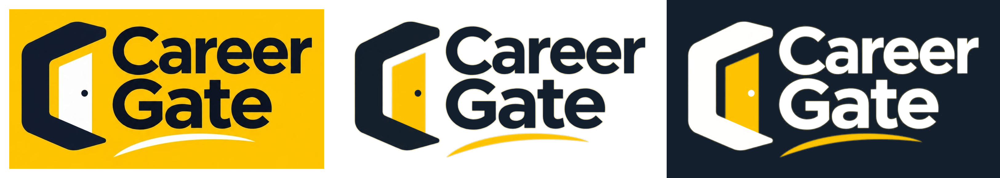
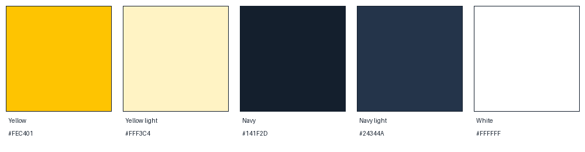

# Career Gate brand assets

Logos, icons, colors and social templates for **Career Gate**
(Real Job Opportunities in Egypt), taken from the official Facebook page
facebook.com/Careergateegypt.

## Logo

| File | Use it on |
|------|-----------|
| `logo/careergate-logo-yellow.png` | Anywhere; logo on its yellow background |
| `logo/careergate-logo-square-yellow.png` | Profile pictures, square avatars (1254 x 1254) |
| `logo/careergate-logo-for-light-bg.png` | White or light backgrounds (transparent, navy and yellow) |
| `logo/careergate-logo-for-dark-bg.png` | Navy or dark backgrounds (transparent, white and yellow) |
| `logo/careergate-logo-original-transparent.png` | Yellow backgrounds or photos (transparent, navy and white, as on the original) |

Keep clear space around the logo of at least the height of the door's knob
area, and never stretch, recolor outside the palette, or put the light
variant on a dark background.

## Icon (door mark)

* `icon/careergate-icon-16.png` to `icon/careergate-icon-512.png`: square app or window icons on yellow.
* `icon/favicon.ico`: website favicon (16, 32, 48, 64 px).
* `icon/careergate-mark-*.png`: door mark alone, transparent, in the same three variants as the logo.

## Colors

| Name | Hex | RGB | Use |
|------|-----|-----|-----|
| Yellow | `#FEC401` | 254, 196, 1 | Main brand color, backgrounds, highlights |
| Yellow light | `#FFF3C4` | 255, 243, 196 | Cards, pills, hover states |
| Navy | `#141F2D` | 20, 31, 45 | Logo, headings, text, buttons |
| Navy light | `#24344A` | 36, 52, 74 | Hover on navy elements |
| White | `#FFFFFF` | 255, 255, 255 | Backgrounds, the door in the logo |

Ready to use in code: `colors/colors.css` (CSS variables) and `colors/colors.json`.

## Typography

The brand uses a bold, rounded geometric sans serif (similar to Montserrat or
Poppins) in navy, with Arabic set in a matching bold Arabic sans (such as Cairo
or Tajawal).

## Social

* `social/facebook-cover-1920x640.png`: the current Facebook cover.
* `social/hiring-post-template-1080.png`: example of the "مطلوب للتوظيف" (now hiring) post layout:
  yellow background, navy rounded cards, white content panels, yellow bullet points.
